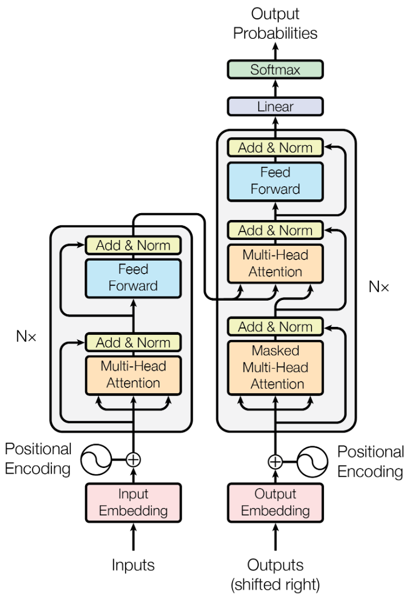

= Encoder Decoder Transformer Architecture
:author: Sean Gies
:date: 2026-11-23
:revdate: 2026-11-24
:toc:
:toclevels: 3
:sectnums:
:reproducible:
:hide-uri-scheme:
:stem: latexmath
:eqnums:
:indent: {nbsp}{nbsp}{nbsp}{nbsp}

== Introduction

Ask a modern LLM to explain a technical document, write a compute program, plan a weekend get away, or help solve a mathematical conjecture,
and you'll get back an astonishingly useful answer. +
{indent}An answer which just a couple of years earlier would have had you convinced there was a human hiden on the other side of the screen. +
{indent}Although, LLMs aren't perfect, and their use can often stand out among the best human content, it's incredible how far
training on a few trillion (stem:[10^{12}]) tokens of text can get you.

Just this past weekend, mathematicians at Anthropic https://alpo.ge/remark.pdf[announced,role=external,window=_blank] a proof to the 
Riemann hypothesis, generated with the help of their Large Language Model, Claude. +
{indent}Anthropic, who just IPO'd for over https://www.reuters.com/legal/transactional/anthropic-prices-blockbuster-ipo-83-share-source-says-2026-11-18/[$1.5 Trillion dollars,window=_blank]
based on the achievements of recent LLMs and the promise of future greatness, published a library comprising over 17 million lines of code almost entirely generated by a LLM. +

Regardless of our opinions on AI as a whole, and it's net effect on society, there's no denying the astonishing achievements and capabilities of a technology
barely a decade old. +
{indent}Originally published in 2017 in a paper titled *Attention is All You Need* by three authors at Google -- one of whom would go on to help found OpenAI -- 
the so called _Transformer_ architecture made away with the old idea of recurrent processing and ushered in a new idea.

[#fig-transformer-arch]

//image::figures/input-matrix.svg[align="center",Input matrix X^(0), width=420]

=== Prior architectures

Although it popularized the idea of an attention mechanism, the transformer was not the first architecture 
to make use of such a concept.

In _2014_ if you were tasked with converting some sequence of inputs into another sequence, you would most likely have
reached for a _Recurrent Neural Network_ (RNN). +
//{indent}RNN's were at the time the state of the art approach to most forms of sequence modelling, although convolution based approaches
//where starting to challenge the top spot. +
{indent}In the same year, *Sutskever, Vinyals, & Le*, presented in their paper _Sequence to Sequence Learning with Neural Networks_ the first
end to end method for translating text using an encoder-decoder architecture.
They had shown that stacking RNNs could directly translate one sequence of text into another without the need of statistical machine translation methods used previously.

//In _2014_ if you were tasked with converting some sequence of inputs _S_ into another 
//sequence _P_ you would most likely have reached for a _Recurrant Neural Network_ (RNN). +
//RNN's date back at least to the 1980s, although the idea of recurrance is most likely even older than that, 
//stemming from the 1950s golden era of AI.

//The idea of recurrance is really quite simple, starting with the first element stem:[x_i] of the sequence, pass it through
//a function `f` to get output stem:[y_i], then pass the next element of the sequence stem:[x_{i+1}] through stem:[f] to get stem:[y_{i+1}].

==== RNNs 

The idea of recurrence can be seen in equation stem:[\eqref{basic_recurrance}], where a state stem:[h_t] depends on its previous state stem:[h_{t-1}]
and some input stem:[x_t].

[stem]
++++
\begin{equation}
\label{basic_recurrance}
h_{t} = h_{t-1} + x_t \\
\end{equation}
++++

A RNN extends this idea of recurrence by iterating a function stem:[\eqref{rnn_recurrance}] over a sequence 
_S:_ stem:[(x_i,...,x_T)] resulting in a sequence _P:_ stem:[(y_i,...,y_T)]. 

[stem]
++++
\begin{equation}
\label{rnn_recurrance}
h_t = sigm(W^{hh}h_{t-1} + W^{hx}x_{t}) \\
y_t = W^{yh} h_t
\end{equation}
++++

First, update the hidden state stem:[h_t] using the current
input stem:[x_t] and the previous hidden state stem:[h_{t-1}]. Then use the updated hidden state to compute the next output stem:[y_t]. +
{indent}The learning of the RNN happens through stem:[(W^{hh}, W^{hx}, W^{yh})], which are learnable weight matrices. By tweaking the values in stem:[W]
the model can learn that certain stem:[(x_t, h_{t-1})] pairs should lead to certain outputs stem:[y_t].

In their 2014 paper _Sequence to Sequence Learning with Neural Networks._, Sutskever, Vinyals, & Le were the first to show that stacked
RNN's could directly translate a sequence of text from one language it another.

== test

.Test application 
[source,python]
----
def main():
    print("Hello, world!")

if __name__ == "__main__":
    main()
----

